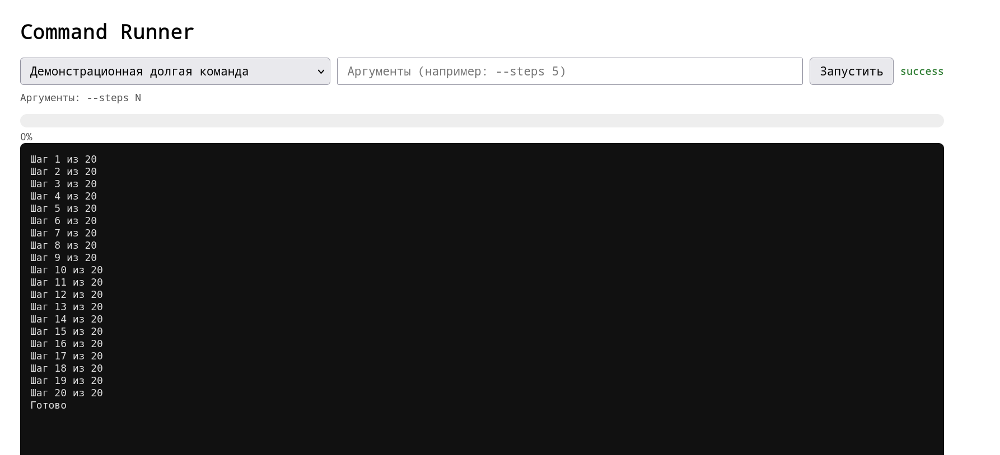

# Command Runner

Read this in [Russian](README.ru.md)

Django application for running management commands from the admin panel with real-time execution monitoring and the ability to forcefully stop them.

## Features

- Run any Django management command from a whitelist via the web interface.
- Pass positional and named arguments in shell format (`--steps 5 --name "Hello World"`).
- Real-time execution monitoring: status, progress bar, log.
- Intercept command stdout/stderr into the run log.
- Stop execution: queued tasks are removed instantly (`job.cancel` for RQ, `revoke` for Celery); running tasks are killed (`send_stop_job_command` / `kill_horse` for RQ, `revoke(terminate=True)` for Celery).
- Support for two queue backends: Celery and RQ (selectable in settings).
- Store state and logs in a shared cache (Redis).
- Access restricted to staff users only.
- Limitation: only one command executes at a time (global lock in Redis).

  

## Requirements

- Python 3.10+
- Django 3.2+
- Redis (for cache and queue)
- One of the queue backends: `celery` + configured broker (Redis/RabbitMQ) or `rq` (uses Redis)

## Installation

### 1. Install dependencies

```bash
pip install django django-redis redis
# for RQ:
pip install rq
# for Celery:
pip install celery
```

### 2. Copy the application

Copy the `admin_cmd_runner/` package to your project (e.g., `your_project_name/apps/admin_cmd_runner/`) and add it to `INSTALLED_APPS`:
```python
INSTALLED_APPS = [
    # ...
    "admin_cmd_runner",
]
```

### 3. Configure `settings.py`

```python
# Queue backend selection: "celery" or "rq"
ADMIN_CMD_RUNNER_QUEUE = "rq"

# Redis for RQ queue
ADMIN_CMD_RUNNER_RQ_REDIS_URL = "redis://redis:6379/2"
ADMIN_CMD_RUNNER_RQ_QUEUE = "default"

# For django-rq worker: without this block, the worker connects to localhost:6379/0
RQ_QUEUES = {
    "default": {"URL": ADMIN_CMD_RUNNER_RQ_REDIS_URL},
    "high":    {"URL": ADMIN_CMD_RUNNER_RQ_REDIS_URL},
}

# Shared cache for state (Redis or Memcached required)
CACHES = {
    "default": {
        "BACKEND": "django_redis.cache.RedisCache",
        "LOCATION": "redis://redis:6379/1",
        "OPTIONS": {
            "CLIENT_CLASS": "django_redis.client.DefaultClient",
        },
    },
}

# Command whitelist
ADMIN_CMD_RUNNER_COMMANDS = [
    {
        "name": "demo_long_command",
        "label": "Demo long command",
        "args_help": "--steps N",
    },
    # ...
]
```

### 4. Connect URL routes

In the project's `urls.py`:
```python
from django.urls import include, path

urlpatterns += [
    path("admin-cmd-runner/", include("admin_cmd_runner.urls")),
]
```

### 5. Start the worker

For RQ:

```bash
# bare RQ:
rq worker default

# or via django-rq:
python manage.py rqworker default
```

For Celery:

```bash
celery -A proj worker -l info
```

### 6. Start the web server

```bash
python manage.py runserver
```

## Usage

1. Open `/admin-cmd-runner/` as a staff user.
2. Select a command from the dropdown list.
3. Enter arguments (optional): positional `arg1 arg2`; named `--steps 5 --name "Hello World"`; flags `--verbose` (without value → `True`); everything after `--` is considered positional.
4. Click "Run". A run page will open with a progress bar and a log updating every second.
5. Click "Stop" to forcefully stop. For queued tasks, stopping is instant; for running tasks, it takes 1–3 seconds (depending on the backend).

## Testing

Tests do not require Redis, a database, or installed `rq`/`celery`: the cache is substituted with `LocMemCache` via `override_settings`, and backend tests are skipped (`skipUnless`) if the corresponding library is not installed.

### Running in the project

If `admin_cmd_runner` is connected in your Django project's `INSTALLED_APPS`:
```bash
# all app tests (by app label)
python manage.py test admin_cmd_runner
# only the test package
python manage.py test admin_cmd_runner.tests
# specific module
python manage.py test admin_cmd_runner.tests.test_store
# specific test class
python manage.py test admin_cmd_runner.tests.test_store.LockTests
# specific method
python manage.py test admin_cmd_runner.tests.test_store.LockTests.test_acquire_and_get
```
If the application is connected by full path (`your_project_name.apps.admin_cmd_runner`), use the label or the full path to the test package:
```bash
python manage.py test apps_admin_cmd_runner
# or
python manage.py test your_project_name.apps.admin_cmd_runner.tests
```

### Running during package development (uv)

From the repository root (where `pyproject.toml` is located):
```bash
# install uv (once)
curl -LsSf https://astral.sh/uv/install.sh | sh
# create a virtual environment and install the package
# in editable mode with all dev dependencies
uv sync --extra dev
# tests with coverage (pytest config is in pyproject.toml)
uv run pytest admin_cmd_runner/tests
# only linter
uv run ruff check admin_cmd_runner tests
# only type checking
uv run mypy admin_cmd_runner
# everything at once (lint + typecheck + test)
uv run ruff check admin_cmd_runner tests \
  && uv run mypy admin_cmd_runner \
  && uv run pytest admin_cmd_runner/tests
```
Dependency management:

```bash
# add a dev dependency
uv add --dev pytest-xdist

# update lock file without installing
uv lock

# synchronize environment with lock file
uv sync --extra dev

# specific Python version
uv python install 3.12
uv venv --python 3.12
```

### Coverage

Coverage threshold is set in `pyproject.toml` (`--cov-fail-under=70`). HTML report:
```bash
uv run pytest admin_cmd_runner/tests --cov-report=html
open htmlcov/index.html
```

### Running in Docker

```bash
docker compose exec django python manage.py test admin_cmd_runner
```

## Architecture

```text
admin_cmd_runner/
 ├── __init__.py             — application description
 ├── apps.py                 — AppConfig
 ├── admin.py                — no models, only menu hint
 ├── urls.py                 — URL routes
 ├── views.py                — monitor, run, stop, status
 ├── forms.py                — form and argument parser
 ├── registry.py             — registry of available commands from settings
 ├── store.py                — state and logs in shared cache
 ├── reporter.py             — Reporter for progress and stopping
 ├── jobs.py                 — transport-independent command execution
 ├── queue/
 │   ├── __init__.py         — backend factory
 │   ├── base.py             — abstract interface
 │   ├── celery_backend.py   — Celery implementation
 │   └── rq_backend.py       — RQ implementation
 ├── management/
 │   └── commands/
 │       ├── _base.py        — ReporterCommand with access to reporter
 │       └── demo_long_command.py — demo command with progress and stop
 └── templates/
     └── admin_cmd_runner/
         └── monitor.html    — UI with polling
```

## Execution Flow

- **Start.** `start_run` validates the form, acquires a global lock (`cache.add`), creates state (`status=queued`), enqueues the task in the backend, and saves `task_id`.
- **Execution.** The worker calls `execute_command`, which casts `kwargs` types according to `add_argument(type=...)`, sets `status=running`, sets `Reporter` as stdout, executes the command via `call_command`, and in `finally` fixes the terminal status and releases the lock.
- **Monitoring.** The frontend requests `status_api` every second, which returns the state and new log lines (`since=N`).
- **Stop.** `stop_run` sets the `stop` flag, calls `backend.revoke(task_id)`: for `queued` — the task is removed, status immediately becomes `stopped`; for `started` — a stop command is sent, status becomes `stopping`, and finalization to `stopped` happens in `status_api` upon the actual death of the backend process (or after `STOP_GRACE_SECONDS` timeout).

## Storage (Redis)

| Key | Purpose | TTL |
| --- | --- | --- |
| `admin_cmd_runner:lock` | ID of active run (one per project) | 24 h |
| `admin_cmd_runner:state:<run_id>` | run state (status, progress, error) | 24 h |
| `admin_cmd_runner:log:<run_id>` | log (list of strings, limited to 2000 entries) | 24 h |
| `admin_cmd_runner:stop:<run_id>` | stop request flag | 6 h |
| `admin_cmd_runner:task:<run_id>` | task_id/job_id in the backend | 24 h |

**Important:** the cache must be shared across all processes (web and worker), so `LocMemCache` is not suitable — Redis or Memcached is required.

## Writing Custom Commands

Inherit from `ReporterCommand` to get access to `self.reporter` (progress, log, stop check):
```python
from admin_cmd_runner.management.commands._base import ReporterCommand

class Command(ReporterCommand):
    help = "What the command does"
    
    def add_arguments(self, parser):
        parser.add_argument("--count", type=int, default=10)
        
    def handle(self, *args, **options):
        count = options["count"]
        for i in range(count):
            self.reporter.check_stop()  # raises CommandStopRequested on stop
            self.stdout.write(f"Step {i + 1}/{count}")  # goes to log
            self.reporter.progress(
                int((i + 1) / count * 100),
                f"Step {i + 1}/{count}",
            )
            # ... useful work ...
```
If a command does not inherit from `ReporterCommand`, it will still go to the log (stdout is intercepted), but it won't be able to update progress and cooperatively check the stop flag (only a hard kill will remain).

## Docker Compose

Example for running together with Redis and an RQ worker:
```yaml
services:
   redis:
     image: redis:7-alpine
     ports:
       - "6379:6379"
   django:
     build: .
     command: python manage.py runserver 0.0.0.0:8000
     volumes:
       - .:/code
     depends_on:
       - redis
   rq:
     build: .
     command: python manage.py rqworker default
     environment:
       - DJANGO_SETTINGS_MODULE=your_project_name.settings.dev
       - PYTHONUNBUFFERED=1
     volumes:
       - .:/code
     depends_on:
       - redis
       - django
     restart: "always"
     # IMPORTANT: do not add stdin_open: true — otherwise rqworker
     # will get EOF on stdin and will terminate every ~30 seconds.
```

## Known Limitations

- Only one command executes at a time (global lock).
- Standard `int`/`float` kwargs parsing works via the command's `add_argument(type=...)`; for custom types (e.g., `datetime`), use a callable `type`, which will be invoked.
- The log is limited to 2000 lines per run (older ones are truncated).
- `kill_horse` in RQ does not allow `finally` to execute — status finalization happens on the web process side via `status_api`.
- 1–2 extra `/status/` requests after clicking "Stop" are inevitable: they fall into the window between the click and the actual death of the worker process.
